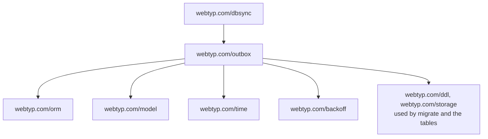

> Read AGENTS.md at the repo root before any change.
> **Finish by yourself:** when the delivery check passes, commit, push and open the pull request. Never ask whether to
> proceed or finalize — nobody answers, and a session that waits ends without your work. Commit after every stage.
> Never run `git reset`, `git restore`, `git checkout -- <file>` or `git stash` on your own work.
> A PR that does not compile, or whose tests could not run, is a failed delivery. Stuck for 30 minutes: open the PR anyway and list what fails.

# Plan: `outbox` uses `backoff`

`outbox.go:236-255` holds a private function `backoff(attempts)` (1 s first delay, doubling, 60 s cap). The ecosystem now has one library for exactly that: `webtyp.com/backoff` (decision D59). This plan makes `outbox` import it and deletes the private copy. **Behaviour does not change**: the same delays for the same attempt numbers.

## Ecosystem search

`webtyp.com/backoff` `v0.1.0` (published today) computes `delay after N failures` with the same rule. **Reuse**. The other private copies (`sse`, `app`, `goflare`) are separate plans in their own repos. No exported symbol of `outbox` changes.

## Design gate

Not required: no exported symbol is added, renamed or removed (the new field and the constants are unexported). Ledger: ways to compute a retry delay in this repo `−1` (the private function dies in this change).

## Tools

```bash
go install webtyp.com/devflow/cmd/gotest@latest
export PATH="$PATH:$(go env GOPATH)/bin"
go get webtyp.com/backoff@v0.1.0
```

Environment: `GOPRIVATE=webtyp.com/*,github.com/veltylabs/*`, `GOFLAGS=-mod=mod`; `go mod tidy` after `go get`.

## APIs used

| symbol | exact signature | tag | file |
|---|---|---|---|
| `backoff.New` | `func New(first, longest time.Nano) (Policy, error)` (`time` is `webtyp.com/time`) | `webtyp.com/backoff v0.1.0` | `backoff.go` |
| `backoff.Policy.DelayAfter` | `func (p Policy) DelayAfter(failures int64) (time.Nano, error)`: 1 failure or fewer → first delay; doubles after each further failure; never above `longest`; the zero `Policy` answers `backoff.ErrPolicyNotCreated` | `webtyp.com/backoff v0.1.0` | `backoff.go` |
| `backoff.Policy` | struct, zero value invalid | `webtyp.com/backoff v0.1.0` | `backoff.go` |

If a signature in the published tag differs from this table, stop and name the symbol in the PR; never adapt it by guessing.

## Stage 1 — pin the behaviour with a test (it must pass before and after)

File: `tests/outbox_test.go` (append). Name: `TestOutbox_RetryDelayDoublesUntilCap`. Setup → call → expected, using the existing helpers `setupOutbox`, `fakeSender` and the `TestOutbox_BackoffCaps` pattern (read it first, it sits at the same file):

```go
func TestOutbox_RetryDelayDoublesUntilCap(t *testing.T) {
	cases := []struct {
		attemptsBefore int64
		want           time.Nano
	}{
		{0, 1000000000},   // first failure: 1 s
		{1, 2000000000},   // 2 s
		{2, 4000000000},   // 4 s
		{5, 32000000000},  // 32 s
		{6, 60000000000},  // 7th failure: capped at 60 s
		{50, 60000000000}, // far beyond the cap
	}
	for _, c := range cases {
		ob, sender, clock, db := setupOutbox(t)
		ob.Enqueue(outbox.Entry{Op: "op", Payload: []byte("A")})
		sender.answers["A"] = outbox.Result{Verdict: outbox.Retry}

		mutation := &outbox.Mutation{}
		query := db.Query(mutation).Where(outbox.Mutation_.Id).Eq("id1")
		outbox.ReadOneMutation(query, mutation)
		mutation.Attempts = c.attemptsBefore
		mutation.NextAttemptAt = *clock
		db.UpdateFields(mutation, []string{outbox.Mutation_.Attempts, outbox.Mutation_.NextAttemptAt}, orm.Eq(outbox.Mutation_.Id, mutation.Id))

		ob.Deliver(sender)

		outbox.ReadOneMutation(query, mutation)
		if got := mutation.NextAttemptAt - *clock; got != c.want {
			t.Errorf("attempts before %d: next attempt in %d, want %d", c.attemptsBefore, got, c.want)
		}
	}
}
```

Run `gotest`: it passes with the **old** code (that proves the new code changes nothing). `outbox` has no `docs/TESTS.md` today: do not create one. Commit.

## Stage 2 — `outbox.go`

1. Imports: add `"webtyp.com/backoff"` (keep the file's import order).
2. In `type Outbox struct` add the field `retry backoff.Policy` after `now`.
3. Replace the constants block and delete the function. Delete exactly these lines (`outbox.go:236-255`): the `const (minBackoff … maxBackoff …)` block and `func backoff(attempts int64) time.Nano {…}`. In their place write:

```go
const (
	firstRetryDelay   time.Nano = 1000000000  // 1 s after the first failure
	longestRetryDelay time.Nano = 60000000000 // 60 s: the delay never grows past this
)
```

4. In `New`, before the `m := &Mutation{}` line add (`err` is declared later in the function, so these use their own names):

```go
	retry, retryErr := backoff.New(firstRetryDelay, longestRetryDelay)
	if retryErr != nil {
		return nil, retryErr
	}
```
and in the `&Outbox{…}` literal add `retry: retry,`.

5. In `Deliver`, in the `case Retry: fallthrough; default:` branch, replace the line `m.NextAttemptAt = o.now() + backoff(m.Attempts)` with:

```go
			delay, delayErr := o.retry.DelayAfter(m.Attempts)
			if delayErr != nil {
				o.mu.Unlock()
				return rep, delayErr
			}
			m.NextAttemptAt = o.now() + delay
```
(`o.mu` is locked at that point; the unlock before the return is required. `delayErr` cannot happen for a policy made by `New`; it is returned and never ignored.)

6. Run `go mod tidy`: `go.mod` now requires `webtyp.com/backoff v0.1.0`. Run `gotest`: every test passes, including Stage 1's and `TestOutbox_BackoffCaps`. Commit.

Deletions, each verified: `grep -n "minBackoff\|maxBackoff\|func backoff" outbox.go` → empty.

## Stage 3 — documentation

- `docs/ARCHITECTURE.md`: add the section `## Retry delay` after the existing «Metaphor» section: «When the server answers `Retry`, the mutation waits 1 s after the first failure and doubles after each further failure up to 60 s. The calculation lives in `webtyp.com/backoff` (one library for every retry delay in the framework).» Link `https://github.com/webtyp/backoff/blob/main/README.md`.
- `docs/diagrams/PLACEMENT.md` (new; this repo has none). Three parts: a context header (2–3 plain sentences: what `outbox` imports, who imports it, where it runs); then


then a numbered walkthrough: outbox runs in the browser (TinyGo WASM) and in tests, `dbsync` is the only repo that imports it today, and `backoff` is the one library that computes retry delays.
- `README.md` stays as it is; if it has a Documentation Map table, add one row for `docs/diagrams/PLACEMENT.md`.

Permanent docs never link `docs/PLAN.md`. English, no client names. Commit.

## Delivery check

1. `gotest` — builds, vets and runs every test; all pass.
2. `grep -n "minBackoff\|maxBackoff\|func backoff" outbox.go` → empty.
3. `grep -n "webtyp.com/backoff" go.mod outbox.go` → one line in each.
4. `git diff --stat main` lists exactly: `outbox.go`, `go.mod`, `go.sum`, `tests/outbox_test.go`, `docs/ARCHITECTURE.md`, `docs/diagrams/PLACEMENT.md`, and (only if it has a Documentation Map) `README.md`.

## Stages

| # | Stage | Files |
|---|---|---|
| 1 | pin the behaviour | `tests/outbox_test.go` |
| 2 | use `backoff`, delete the copy | `outbox.go`, `go.mod`, `go.sum` |
| 3 | documentation | `docs/ARCHITECTURE.md`, `docs/diagrams/PLACEMENT.md`, `README.md` |
