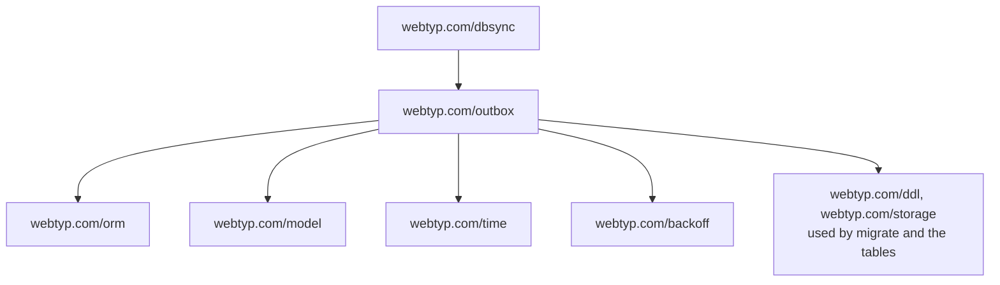

# Placement

`webtyp.com/outbox` runs in the browser (TinyGo WASM) and in tests. It uses `webtyp.com/orm`, `webtyp.com/model`, `webtyp.com/time`, and `webtyp.com/backoff`. It is currently used by `webtyp.com/dbsync`.

1. Runs in the browser (TinyGo WASM) and in tests.
2. `webtyp.com/dbsync` is the only repository that imports it today.
3. `webtyp.com/backoff` is the one library that computes retry delays.
